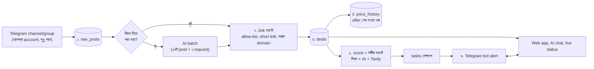

# OfferRadar — সিস্টেম প্ল্যান

**লক্ষ্য:** Amazon, Flipkart, Meesho-র offer আর অনেকগুলো Telegram channel/group-এর deal ২৪/৭ নজরে রাখা, link ও scam যাচাই করা, সব layer-এ সাজিয়ে সংরক্ষণ করা, আর আপনাকে web app + AI chat + Telegram-এ জানানো।

## ১. মূল নীতি

1. **AI শেষ ধাপে।** নিয়ম (regex, domain allow-list) দিয়ে যা পড়া যায় তাতে AI লাগে না। AI শুধু জটিল post, গভীর যাচাই আর chat-এ।
2. **AI কিছু বানাবে না।** দাম, link, ছাড় সবসময় post বা API থেকে আসে। AI শুধু সেগুলো পড়ে আর বিচার করে। AI চাইলেও post-এ নেই এমন link যোগ করতে পারে না।
3. **Telegram আর ওয়েবের লেখা অবিশ্বস্ত তথ্য।** তাই prompt-এ সেগুলোকে "data" হিসেবে আলাদা করা, আর AI-র উত্তর কঠোরভাবে যাচাই করা হয়।
4. **প্রমাণ ছাড়া নিশ্চয়তা নয়।** প্রতিটা রায়ের সঙ্গে confidence, কারণ আর ঝুঁকি। দাম "channel-এর দাবি" নাকি "দোকানে যাচাই করা", তা সবসময় দেখানো হয়।
5. **সিস্টেম কখনো থামে না।** AI বা key শেষ হলে নিয়ম দিয়ে চলে, পরে AI ফিরলে বাকিটা ধরে নেয়।

## ২. কাঠামো

| Layer | কাজ | কোথায় সংরক্ষণ |
|---|---|---|
| ১ Collect | channel-এর নতুন/সম্পাদিত post, লুকানো link, link-বোতাম, ছবি | `raw_posts` |
| ২ Parse + Link | দাম/MRP/coupon/ফ্রি পড়া, short link খোলা, allow-list, নকল domain আটকানো | `deals`, `blocked` |
| ৩ Verify | link চালু কিনা (404), scam লক্ষণ, AI রায়, API-র তথ্য (পেলে) | `deals.verdict_json` |
| ৪ Track | দামের ইতিহাস, "শেষ" ধরা (channel-এ শেষ নোটিস, মরা link, অনেকক্ষণ repost নেই) | `price_history`, `deals.status` |
| ৫ Score | ছাড়, কত channel-এ এসেছে, channel-এর ভরসা, যাচাই, scam লক্ষণ → ০-১০০ | `deals.score`, `channels.trust` |
| ৬ Reply | task মেলানো, Telegram alert, web chat, live status | `tasks`, `alerts`, `chat` |

## ৩. AI ব্যবহারের হিসাব (মিনিটে ১০-১৪, দিনে ~২০০০)

- মিনিটে সর্বোচ্চ **১০** (সীমার নিচে নিরাপদ ফাঁক), প্রতি provider-এ আলাদা window।
- দিনের ভাগ: post পড়া ৫০০, গভীর যাচাই ৬০০, chat ৫০০, alert-এর আগে যাচাই ৩০০, জমা ১০০ (শুধু chat/alert)।
- ৯০% খরচ হলে শুধু chat আর alert-এ AI চলে।
- Priority: **chat > alert > গভীর যাচাই > post পড়া।** আপনি কখনো background কাজের পেছনে আটকে থাকবেন না।
- ১০টা post এক request-এ, ছোট JSON উত্তর, ৬ ঘণ্টার cache।
- ১ম key limit-এ ঠেকলে ২য় key; দুটোই বন্ধ হলে নিয়ম-মোড, পরে ধরে নেওয়া।
- Tavily: মাসে ৯০০, দিনে ৩০ credit-এর কড়া সীমা, শুধু ভালো score-এর deal-এ, ২৪ ঘণ্টার cache।

## ৪. Scam / fake ঠেকানো

- শুধু `amazon.in`, `flipkart.com`, `meesho.com` চূড়ান্ত গন্তব্য। বাকি সব আটকানো হয়, **খোলাই হয় না**।
- Short link এক ধাপ করে খোলা হয়, শুধু চেনা shortener, শুধু redirect header পড়ে।
- নকল domain (`amazon-offers.xyz`, `amazon.in.evil.com`, `user@host`, punycode) সঙ্গে সঙ্গে blocked, আর সেই channel-এর ভরসা কমে।
- Post-এর লক্ষণ: OTP চাওয়া, টাকা/UPI পাঠানো, APK, "১০ group-এ forward", লটারি, ৯০%+ ছাড়।
- গুরুতর লক্ষণ থাকলে AI "কিনুন" বললেও নিয়ম সেটা **avoid** করে দেয়।
- একই deal ৩+ channel-এ এলে প্রথম channel-এর ভরসা বাড়ে; মরা/নকল link দিলে কমে।

## ৫. Task (২৪/৭ নজর) কীভাবে কাজ করে

1. chat বা Telegram-এ বলুন: "boat earbuds ১০০০ টাকার নিচে চাই"।
2. AI (বা নিয়ম) থেকে task: keyword, সর্বোচ্চ দাম, দোকান।
3. আগের জমা deal-এ মিলে গেলে সঙ্গে সঙ্গে, নইলে প্রতিটা নতুন/আপডেট deal-এ মেলানো হয়।
4. মিললে: গভীর যাচাই (পণ্যটা সত্যিই আপনার চাওয়ার সঙ্গে মেলে কিনা সহ)। `avoid` বা অমিল হলে task অপেক্ষায় থাকে।
5. পাস করলে Telegram-এ ছবি, দাম, রায়, "খুলুন / আবার যাচাই / task বন্ধ" বোতাম। web app-এ status: **অপেক্ষায় → যাচাই চলছে → সম্পন্ন**।

## ৬. ধাপ ও বর্তমান অবস্থা

- [x] **M1** repo কাঠামো, database schema, config
- [x] **M2** Telegram পাঠক → parse → link যাচাই → সংরক্ষণ → alert
- [x] **M3** scoring, দামের ইতিহাস, "শেষ" ধরা, AI + নিয়মের যাচাই, Tavily
- [x] **M4** web app (Flipkart-ধাঁচের layout, ৩D hero/card), AI chat, live status, task
- [ ] **M5** আসল key দিয়ে পরীক্ষা, ২৪/৭ hosting, Amazon Creators API, Flipkart API যাচাই
- [ ] **পরে** Meesho-র জন্য official API নেই (আমার জানামতে), তাই channel + যাচাই নির্ভর; বিজ্ঞপ্তির ধরন বাড়ানো; একাধিক user

## ৭. জানা সীমাবদ্ধতা (সৎভাবে)

- দাম "channel-এর দাবি" থাকে যতক্ষণ official API যুক্ত না হয়। Amazon/Flipkart-এর পাতা scrape করা হয় না (block + terms)।
- Amazon-এর পুরোনো PA-API বন্ধ, নতুন Creators API-র জন্য approved Associates account লাগে। Adapter এখনো লেখা হয়নি।
- Flipkart adapter **পরীক্ষামূলক**: endpoint ও field নাম docs দেখে মিলিয়ে তবে চালু করবেন।
- কোনো system fake review ১০০% ধরতে পারে না। রায় একটা সহায়ক মত, চূড়ান্ত সিদ্ধান্ত আপনার।
- Telegram-এ নিজের account দিয়ে পড়া Telegram-এর নিয়মে ঝুঁকিহীন নয়। শুধু পড়ে, কিছু পাঠায় না বা join করে না; তবু ঝুঁকি আপনার।
